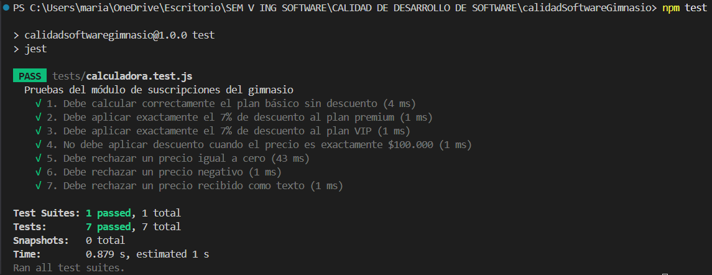
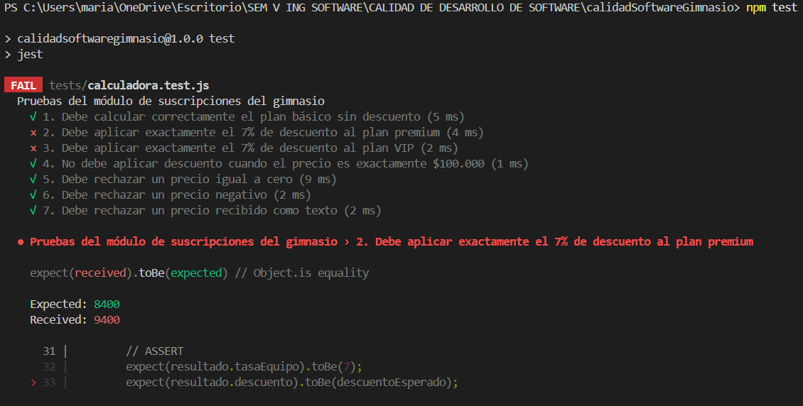
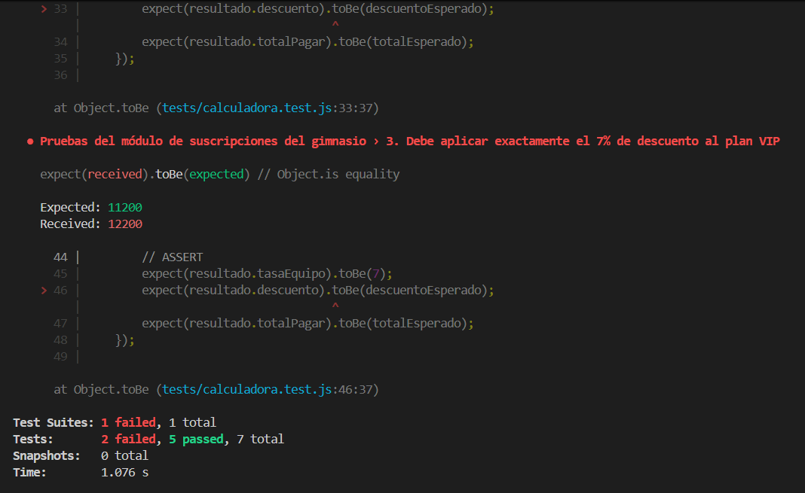
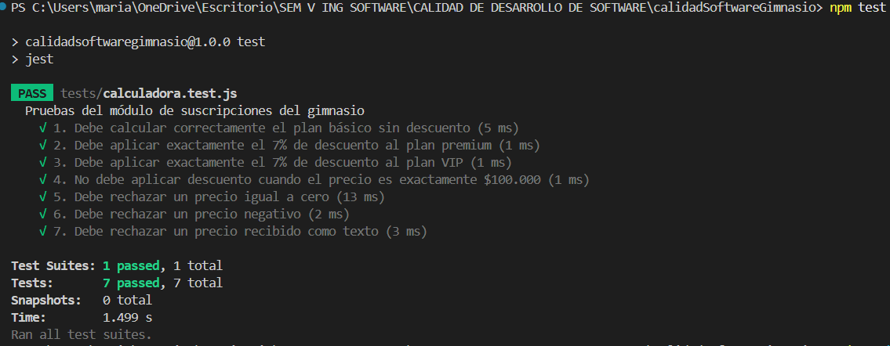

# Sistema de cálculo de suscripciones de gimnasio

Este proyecto consiste en el desarrollo de un módulo de lógica de negocio utilizando Node.js, encargado de calcular el valor final de las suscripciones de un gimnasio.

El sistema permite validar los datos de entrada, calcular un descuento según las reglas establecidas y determinar el valor que debe pagar el cliente.

Además, se implementaron pruebas unitarias automatizadas utilizando Jest para verificar el funcionamiento correcto del módulo, incluyendo casos normales y casos borde.

2. Reglas del negocio

El gimnasio ofrece tres planes de suscripción:

| Plan - Precio |
| Básico - $80.000 |
| Premium - $120.000 |
| VIP - $160.000 |

La regla de descuento establece que:

- Si el precio de la suscripción es superior a $100.000, se aplica un descuento.
- Si el precio es igual o inferior a $100.000, no se aplica descuento.
- El porcentaje de descuento se calcula mediante la fórmula establecida para el equipo.

Cálculo de la tasa del equipo

Número de lista: 22

Fórmula:

`tasaEquipo = (N % 5) + 5`

Reemplazando:

`tasaEquipo = (22 % 5) + 5`

`tasaEquipo = 2 + 5 = 7%`

El porcentaje de descuento aplicado es del 7%

Ejemplos:

| Plan - Precio original - Descuento - Total a pagar |
| Básico - $80.000 - $0 - $80.000 |
| Premium - $120.000 - $8.400 - $111.600 |
| VIP - $160.000 - $11.200 - $148.800 |

3. Integrantes del equipo

|#22 - Mariana Valencia Castaño |

4. Tecnologías utilizadas

-Node.js: entorno de ejecución de JavaScript.
-Jest: framework utilizado para ejecutar las pruebas unitarias.
-JavaScript: lenguaje utilizado para implementar la lógica de negocio.
-Git: sistema de control de versiones.

5. Estructura del proyecto

```text
calidad-software-gimnasio/
│
├── evidencias/
│   └── pruebasAprobadas.png
│   └── pruebasCorregidas.png
│   └── pruebasFallidas1.png
│   └── pruebasFallidas2.png
│
├── src/
│   └── calculadora.js
│
├── tests/
│   └── calculadora.test.js
│
├── .gitignore
├── package.json
├── package-lock.json
└── README.md
```

6. Ejecución del proyecto

Para ejecutar las pruebas se deben seguir estos pasos:

1. Abrir una terminal en la carpeta principal del proyecto.
2. Instalar las dependencias: npm install
3. Ejecutar las pruebas automatizadas: npm test

7. Pruebas unitarias implementadas

Se desarrollaron siete pruebas unitarias utilizando la estructura AAA (Arrange, Act, Assert).

| 1 -> Normal: Calcular el plan básico de $80.000 (Sin descuento) Total: $80.000 |
| 2 -> Normal: Calcular el plan Premium de $120.000 (Descuento: $8.400) Total: $111.600 |
| 3 -> Normal: Calcular el plan VIP de $160.000 (Descuento: $11.200) Total: $148.800 |
| 4 -> Borde: Calcular una suscripción de exactamente $100.000 (Sin descuento) Total: $100.000 |
| 5 -> Borde: Ingresar un precio igual a cero -> Rechazar la entrada |
| 6 -> Borde: Ingresar un precio negativo -> Rechazar la entrada |
| 7 -> Borde: Ingresar el precio como texto -> Rechazar la entrada |

8. Resultados de las pruebas

Al ejecutar el comando `npm test`, se obtuvo el siguiente resultado:

- Suites de pruebas aprobadas: 1.
- Pruebas aprobadas: 7.
- Pruebas fallidas: 0.

Todas las pruebas unitarias fueron ejecutadas satisfactoriamente.

9. Control de versiones

El proyecto utiliza Git para registrar los cambios realizados durante el desarrollo.

Los commits realizados hasta el momento son:

1. Configurar proyecto Node.js y Jest.
2. Crear lógica de cálculo y validación de suscripciones.
3. Agregar pruebas unitarias normales y casos borde.
4. Documentar reglas de negocio y resultados de pruebas.

10. Evidencias

- Ejecución de las siete pruebas con resultado satisfactorio.

- Ejecución de las pruebas después de introducir un error intencional.


- Ejecución de las pruebas después de corregir el error.
